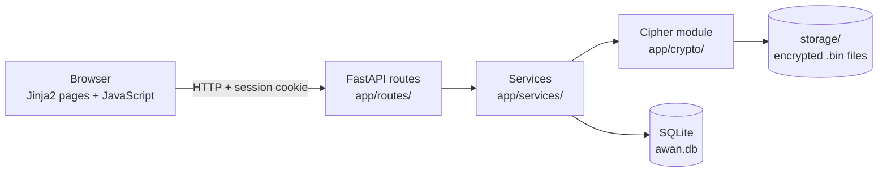
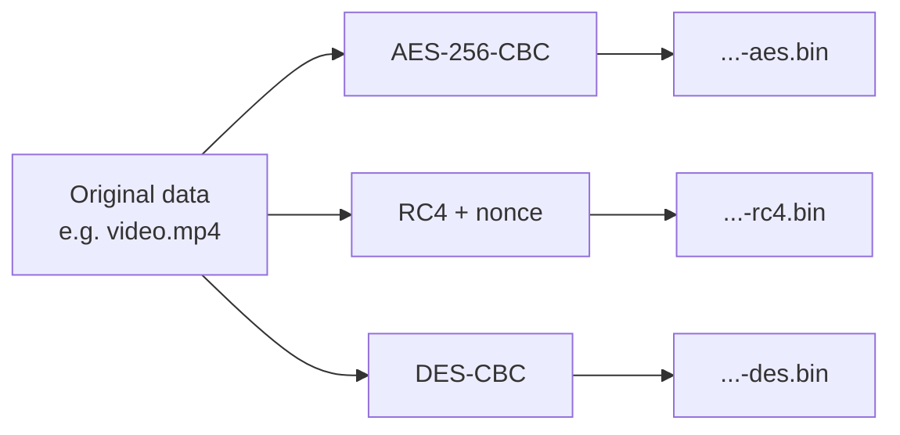
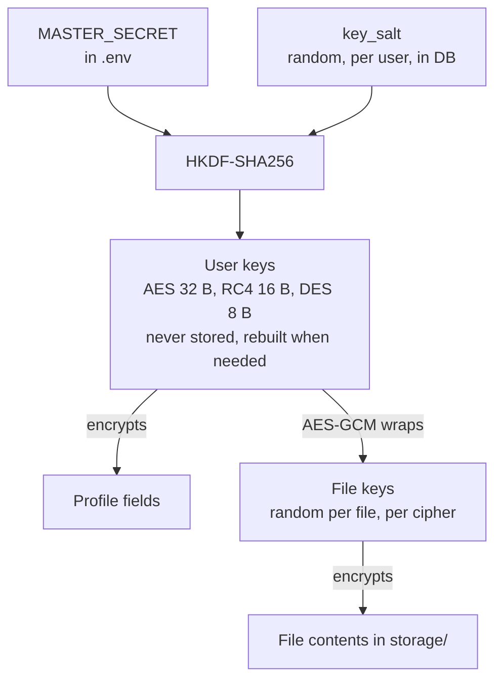
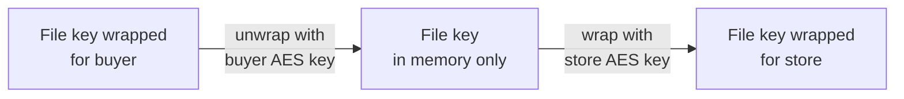
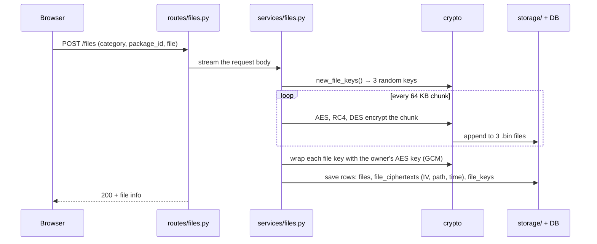
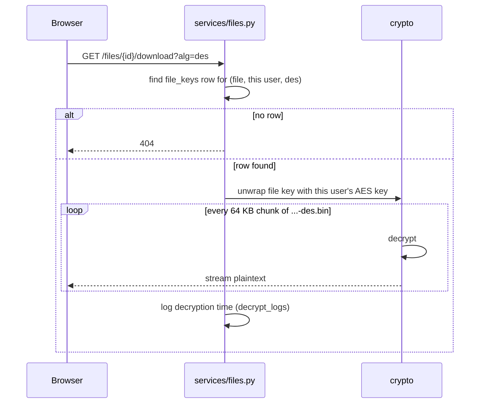
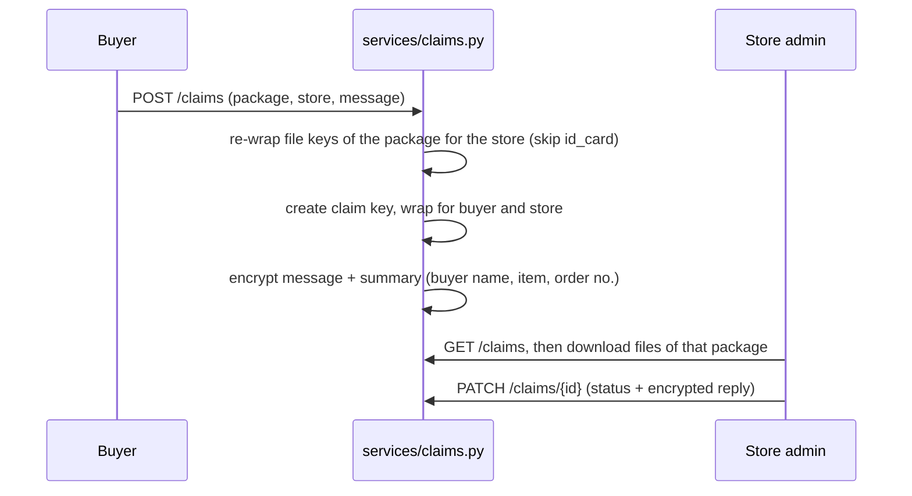

# Awan: an encrypted evidence vault for online-shop disputes

Information Security (Keamanan Informasi), ITS, Assignment 1, Group 11.

Awan lets an online shopper keep the evidence for a damaged or wrong parcel (unboxing video, invoice, documents) together with their identity data in a private vault. Everything is stored encrypted with **AES, RC4 and DES**. A store can only see the files of one package, and only after the buyer files a claim against that store. The store never sees the buyer's ID card, NIK, phone number or bank account.

This README is written so that you can come back after a long time, run the app again, and understand how it works without reading every file. The diagrams render directly on GitHub.

---

## Contents

1. [Run it in five minutes](#1-run-it-in-five-minutes)
2. [A demo you can follow](#2-a-demo-you-can-follow)
3. [The big picture](#3-the-big-picture)
4. [How encryption works here](#4-how-encryption-works-here)
5. [The three main flows](#5-the-three-main-flows)
6. [What is stored where](#6-what-is-stored-where)
7. [Repository map](#7-repository-map)
8. [Tests and benchmark](#8-tests-and-benchmark)
9. [Known limitations](#9-known-limitations)
10. [Glossary](#10-glossary)

---

## 1. Run it in five minutes

You need Python 3.10 or newer.

```bash
# 1. Create a virtual environment and install dependencies
python -m venv .venv
source .venv/bin/activate            # Windows: .venv\Scripts\activate
pip install -r requirements.txt

# 2. Create the config file
cp .env.example .env                 # Windows: copy .env.example .env
```

Open `.env` and fill in the two secrets. Generate them with:

```bash
python -c "import os,base64;print(base64.b64encode(os.urandom(32)).decode())"   # paste as MASTER_SECRET
python -c "import secrets;print(secrets.token_urlsafe(48))"                     # paste as JWT_SECRET
```

```bash
# 3. Create demo accounts (two stores and one buyer)
python scripts/seed.py --password rahasia123

# 4. Start the server
uvicorn app.main:app --reload
```

Open <http://localhost:8000/masuk> and log in. The interactive API documentation is at <http://localhost:8000/docs>.

| Username   | Role        | Store name    |
| ---------- | ----------- | ------------- |
| `dzaky`    | buyer       |               |
| `elektra`  | store admin | Toko Elektra  |
| `gadgetin` | store admin | Toko Gadgetin |

**If something breaks after a `git pull`:** there are no database migrations. Delete `awan.db` and the `storage/` folder, then run `scripts/seed.py` again.

**Never share `.env`.** Anyone who has `MASTER_SECRET` can rebuild every user's keys.

---

## 2. A demo you can follow

This is the order used in the presentation. Each step says what to show and what is happening underneath.

| #   | Do this                                                              | What happens underneath                                                                                                        |
| --- | -------------------------------------------------------------------- | ------------------------------------------------------------------------------------------------------------------------------ |
| 1   | Log in as `dzaky`                                                    | Password is checked against a bcrypt hash. A session cookie (JWT) is set.                                                      |
| 2   | Open **Profil & KTP**, fill in the profile, upload an ID card photo  | The profile JSON is encrypted three times (AES, RC4, DES). The photo is encrypted three times into `storage/`.                 |
| 3   | Open **Simpan unboxing**, upload a video and an invoice              | Each file is streamed in 64 KB chunks and encrypted three times while it is uploaded. Nothing is written to disk in plaintext. |
| 4   | Open the package and download the video with AES, then RC4, then DES | The same file comes back from three different ciphertexts. All three are identical to the original.                            |
| 5   | Open `storage/` in a file explorer and try to open a `.bin` file     | It is unreadable, and the file name says nothing about the content.                                                            |
| 6   | File a claim against **Toko Elektra**                                | The package's file keys are re-wrapped for Elektra. The ID card is skipped.                                                    |
| 7   | Log out, log in as `elektra`, open the claim                         | Elektra can play the video and read the invoice, but sees no NIK, phone, bank account or ID card.                              |
| 8   | Log in as `gadgetin` and try the same file URL                       | 404. Gadgetin has no key for that file.                                                                                        |
| 9   | Open **Statistik**                                                   | Encryption and decryption time per algorithm, taken from real uploads and downloads.                                           |

---

## 3. The big picture



- **Routes** (`app/routes/`) only handle HTTP: read the request, check who is logged in, call a service, return JSON.
- **Services** (`app/services/`) hold the logic: who may see what, which keys to use, what to save.
- **The cipher module** (`app/crypto/`) knows nothing about users or HTTP. It only encrypts and decrypts bytes.
- **SQLite** stores metadata, encrypted profile fields and wrapped keys. **`storage/`** stores the encrypted file contents.

---

## 4. How encryption works here

### 4.1 Every item is encrypted three separate times



The three copies are **independent, not layered**. The assignment requires every item to be protected with each cipher, and keeping them separate lets us download and time each cipher on its own. The cost is three times the storage.

| Cipher | Mode   | Key                         | IV or nonce                         | Padding |
| ------ | ------ | --------------------------- | ----------------------------------- | ------- |
| AES    | CBC    | 32 bytes (AES-256)          | random 16-byte IV per ciphertext    | PKCS#7  |
| DES    | CBC    | 8 bytes (56 effective bits) | random 8-byte IV per ciphertext     | PKCS#7  |
| RC4    | stream | 16 bytes                    | random 16-byte nonce per ciphertext | none    |

**Why CBC and not ECB?** ECB encrypts equal blocks to equal output, so patterns in an image or video stay visible. CBC mixes each block with the previous ciphertext block, starting from a random IV, so equal blocks look different.

**Why does RC4 need a nonce?** RC4 has no IV. Using the same key twice gives the same keystream, and XOR-ing two ciphertexts would then cancel the keystream out. So every RC4 ciphertext uses its own key: the first 16 bytes of `HMAC-SHA256(rc4_key, random_nonce)`.

### 4.2 Where the keys come from



There are two layers of keys:

1. **User keys** are derived from the server's `MASTER_SECRET` and a random salt per user (`app/crypto/keys.py`). They are never saved. They are recomputed every time.
2. **File keys** are random and new for every uploaded file (one per cipher). The file is encrypted with the file key, and the file key itself is stored only in **wrapped** form: encrypted with AES-256-GCM under the owner's AES user key (`file_keys` table).

Why two layers? Sharing a file with a store only needs a new wrapped copy of a small key, not a re-encryption of a 100 MB video. And because GCM is authenticated, any change to a wrapped key is detected.

### 4.3 How a store gets access (key re-wrapping)



When a buyer files a claim (`app/services/claims.py`), the server unwraps each file key of that package with the buyer's key and wraps it again with the store's key. A new row is added to `file_keys` for the store. **Files in the `id_card` category are always skipped.** A store that has no row in `file_keys` for a file gets 404, so it cannot even tell that the file exists.

Claim messages and replies are encrypted with a separate random **claim key**, wrapped for both the buyer and the store (`claim_keys` table).

---

## 5. The three main flows

### 5.1 Uploading a file



Details worth remembering:

- The browser must send `category` and `package_id` **before** `file` in the form data, because the server checks size limits and file type while streaming. (This was a real bug we fixed.)
- Size limits are enforced during streaming: ID card 5 MB, documents 20 MB, video 100 MB. Going over returns 413 and deletes the partial files.
- File type is checked by extension, MIME type and the first bytes of the file.
- Encryption time per cipher is recorded (`enc_time_ms`) and shown on the statistics page.

### 5.2 Downloading a file



### 5.3 Filing a claim



---

## 6. What is stored where

| Data                                                                                     | Where                                          | Protected how                                          |
| ---------------------------------------------------------------------------------------- | ---------------------------------------------- | ------------------------------------------------------ |
| Username, role                                                                           | `users`                                        | plaintext (needed to log in)                           |
| Password                                                                                 | `users.password_hash`                          | bcrypt hash, not encryption                            |
| Profile (name, NIK, birth date, address, phone, bank account, religion, health notes...) | `profile_ciphertexts`                          | JSON encrypted 3 times, one row per cipher             |
| Package info (item name, store, order number)                                            | `packages.meta_ciphertext`                     | AES with the user key                                  |
| Original file name                                                                       | `files.name_ciphertext`                        | AES with the user key                                  |
| File contents                                                                            | `storage/xx/<uuid>-aes.bin` etc.               | 3 ciphertexts with random file keys                    |
| File keys                                                                                | `file_keys`                                    | AES-256-GCM wrapped, one row per file, user and cipher |
| Claim messages and replies                                                               | `claims`, `claim_replies`                      | AES with the claim key                                 |
| Claim key                                                                                | `claim_keys`                                   | AES-256-GCM wrapped for buyer and store                |
| Timing data                                                                              | `file_ciphertexts.enc_time_ms`, `decrypt_logs` | plaintext (no personal data)                           |

**Personal data classification (UU PDP and GDPR).** The bank account (financial data) and health notes are specific personal data under UU PDP Article 4. Religion is general data under UU PDP but a special category under GDPR Article 9, so we follow the stricter rule and make both religion and health notes optional. The ID card photo shows a face, so it is never shared with a store. The full reasoning is in the report and in `docs/PRD.md`.

---

## 7. Repository map

```
app/
  main.py              Creates the FastAPI app, includes routers, serves static files
  config.py            Reads .env (fails to start if secrets are missing)
  db.py, models.py     Database connection and all tables
  schemas.py           Request and response shapes (Pydantic)
  deps.py              "Who is logged in?" and role checks
  security/            bcrypt passwords, JWT session cookie
  crypto/              The cipher module (start reading here)
    aes.py, des.py     AES-256-CBC and DES-CBC, both built on _cbc.py
    _cbc.py            Streaming CBC with PKCS#7 padding, shared by AES and DES
    rc4.py             RC4 with a per-ciphertext key from HMAC(key, nonce)
    keys.py            HKDF user keys, random file keys
    vault.py           One interface for all three ciphers + AES-GCM key wrapping
  services/            Business logic: profile, files, packages, claims, stats
  routes/              HTTP endpoints (pages.py renders the HTML pages)
  templates/, static/  Frontend: Jinja2 pages, CSS, JavaScript
scripts/
  seed.py              Creates demo accounts
  demo_e2e.py          Runs the whole demo scenario against a real server
  benchmark.py         Measures AES vs RC4 vs DES (see section 8)
  fig.py               Draws the benchmark chart used in the report
results/               Raw benchmark output (CSV and JSON)
tests/                 Automated tests (pytest)
docs/
  PRD.md               Requirements: scope, encryption design, schema, API
  api-contract.md      Example JSON for every endpoint
  hasil-pengujian.md   Test results and limitations (Indonesian)
  FE-NOTES.md, FE-NEEDS.md   Frontend working notes
CLAUDE.md              Backend brief, also used as instructions for Claude Code
CLAUDE-FE.md           Frontend brief, also used as instructions for Claude Code
```

`CLAUDE.md` and `CLAUDE-FE.md` are kept on purpose. They show how we instructed our AI coding assistant, which the assignment asks us to disclose.

**Suggested reading order for the code:** `app/crypto/vault.py` → `app/crypto/_cbc.py` → `app/crypto/rc4.py` → `app/crypto/keys.py` → `app/services/files.py` → `app/services/claims.py`.

---

## 8. Tests and benchmark

```bash
pytest -q                                   # about 300 tests, around 2 minutes
python scripts/demo_e2e.py                  # full demo scenario on a temporary server, 10 MB video
python scripts/demo_e2e.py --video-mb 50    # same, with a bigger video
```

The tests check, among other things, that every cipher returns the exact original bytes, that the same data never encrypts to the same ciphertext twice, that other users get 404, that a claim never shares the ID card, and that no plaintext appears in `storage/` or the database file.

### Benchmark

```bash
python scripts/benchmark.py                 # 1, 10 and 50 MB, 5 repetitions each
python scripts/fig.py results/<file>.csv  # redraws the chart (needs matplotlib)
```

The script uses the same encryption classes as the server, processes data in 64 KB chunks like a real upload, discards one warm-up run, repeats each test five times, and checks every round-trip. Disk and network are excluded on purpose, so the result reflects only the cipher. Output goes to `results/`.

Results on our machine (Intel Core i9-13900H, two runs):

| Cipher      | Encrypt (ms/MB) | Relative to AES |
| ----------- | --------------- | --------------- |
| AES-256-CBC | about 1.95      | 1.0             |
| RC4         | about 3.15      | about 1.6       |
| DES-CBC     | about 12.9      | about 6.5       |

What it means: encrypting a 100 MB video with all three ciphers takes about 1.8 seconds, while uploading it over 20 Mbit/s takes about 40 seconds. Speed does not decide which cipher to use. Security does, and only AES is still secure.

The older numbers in `docs/hasil-pengujian.md` were a single early measurement. Use `results/` for the final numbers.

---

## 9. Known limitations

These are deliberate trade-offs or things we did not have time for. Be ready to explain them.

1. **RC4 and DES are not secure.** They are used because the assignment requires them. RC4's first keystream bytes are not discarded.
2. **Not end-to-end encryption.** The server holds `MASTER_SECRET`, so in theory the server could rebuild every user key.
3. **No integrity check on file ciphertext.** CBC and RC4 do not detect tampering. Only the wrapped keys (AES-GCM) do. The fix would be encrypt-then-MAC with HMAC-SHA256.
4. **Videos cannot be seeked.** Downloads do not support HTTP Range, so a video plays from the start only.
5. **No login rate limiting.**
6. **Logging out deletes the cookie, but a stolen token stays valid** until it expires (60 minutes).
7. **A rejected claim does not revoke the store's access** to files already shared.
8. **No database migrations.** A schema change means deleting `awan.db` and `storage/`.

---

##10

**Full demo video:** [watch the complete walkthrough on Google Drive](https://drive.google.com/file/d/15lFsPqCemyviRoEnEO90T4IT1u_WnbbF/view?usp=sharing)

---

## 10. Glossary

| Term                       | Plain meaning                                                                                                                               |
| -------------------------- | ------------------------------------------------------------------------------------------------------------------------------------------- |
| **Plaintext / ciphertext** | Readable data / encrypted data.                                                                                                             |
| **Block cipher**           | Encrypts fixed-size blocks (AES 16 bytes, DES 8 bytes). Needs a mode to handle longer data.                                                 |
| **Stream cipher**          | Produces a keystream that is XOR-ed with the data byte by byte (RC4).                                                                       |
| **Mode of operation**      | The rule for chaining blocks together. ECB (unsafe, leaks patterns), CBC (used here), CTR, GCM.                                             |
| **IV**                     | Initialization vector. A random starting value so the same data encrypts differently every time. Not secret, stored next to the ciphertext. |
| **Nonce**                  | "Number used once". Same idea as an IV. Here it makes every RC4 key unique.                                                                 |
| **Padding (PKCS#7)**       | Extra bytes added so the data fills the last block. Each added byte holds the number of bytes added.                                        |
| **HKDF**                   | A function that turns one secret plus a salt into several strong keys.                                                                      |
| **Salt**                   | A random value per user, so two users never get the same keys.                                                                              |
| **Key wrapping**           | Encrypting a key with another key, so the key can be stored and shared safely.                                                              |
| **AES-GCM**                | AES in a mode that also produces an authentication tag, so any change is detected. Used here for key wrapping.                              |
| **bcrypt**                 | A slow one-way hash for passwords. Passwords are hashed, never encrypted, so they cannot be recovered.                                      |
| **JWT**                    | A signed token stored in the session cookie that says who you are and your role.                                                            |
| **404 instead of 403**     | "Not found" instead of "forbidden", so an attacker cannot learn that a resource exists.                                                     |

---

## Team

| Name                          | NRP        |
| ----------------------------- | ---------- |
| Muhammad Ilyas Rusdi          | 5025241007 |
| Muhammad Dzaky Radithya Ryrdi | 5025241010 |
| Muhammad Ari Fathan Mahardika | 5025241013 |
| Bismantaka Revano Dirgantara  | 5025241075 |
